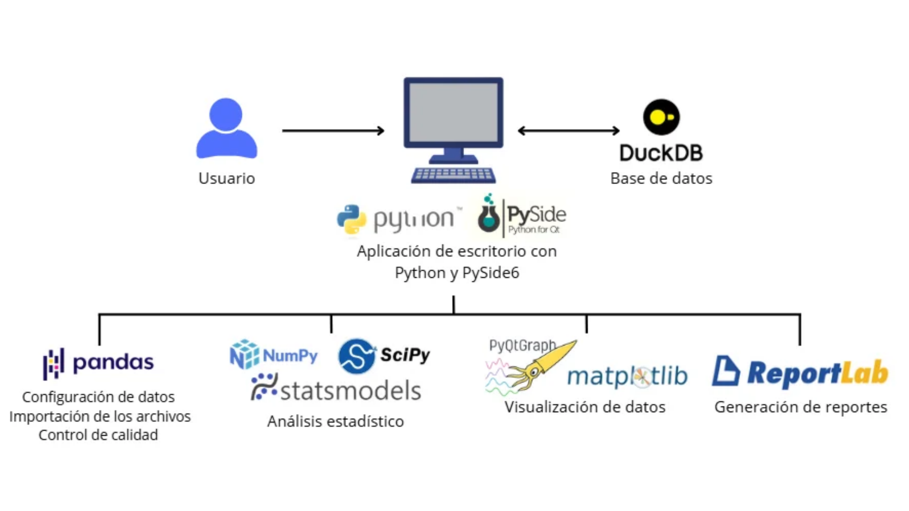
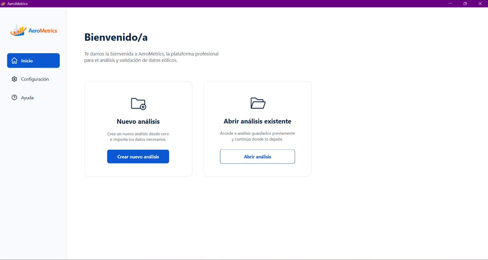
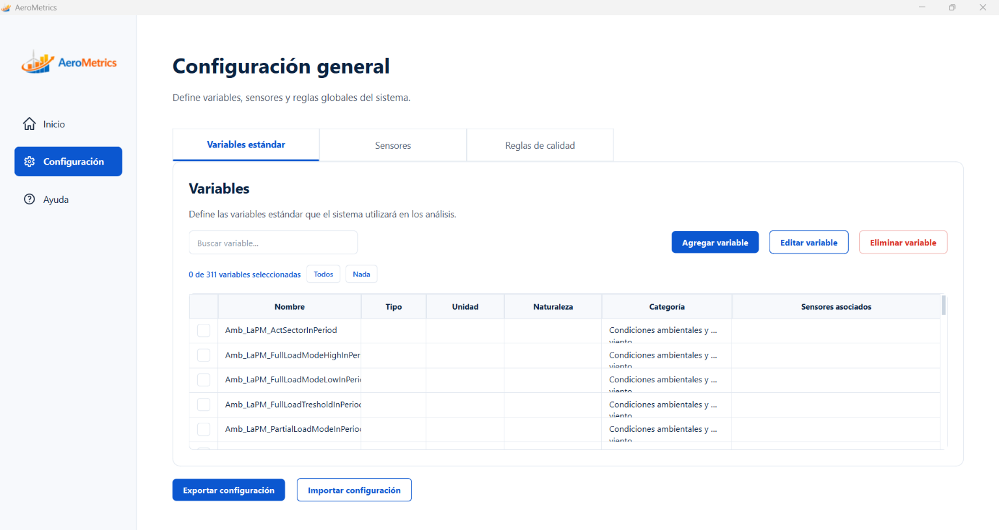
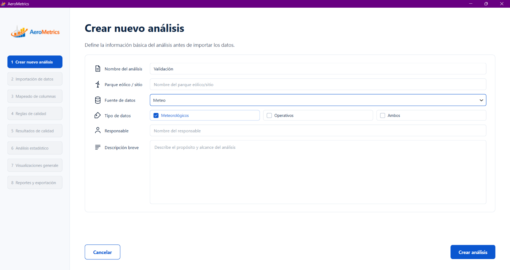
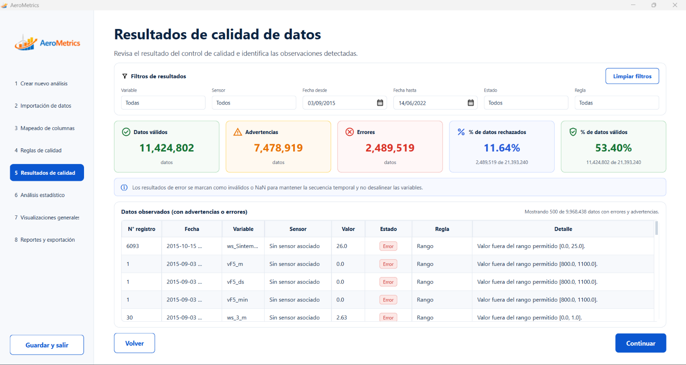
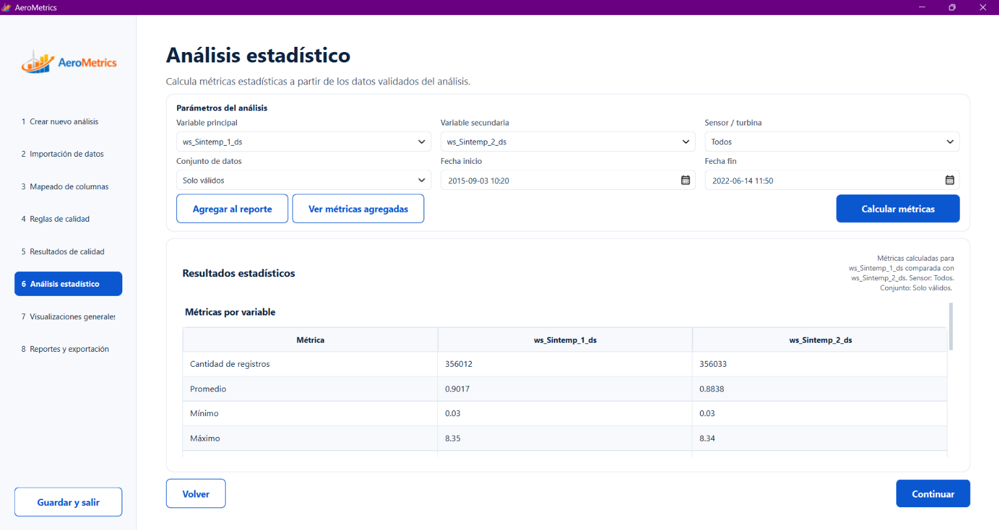
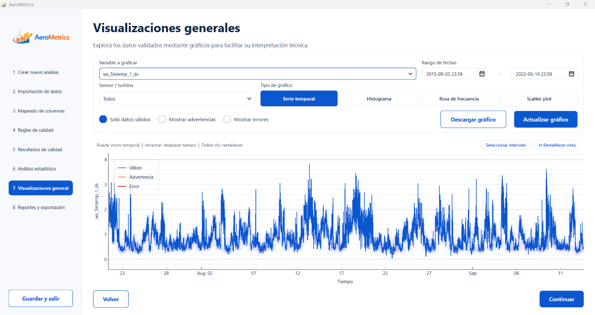
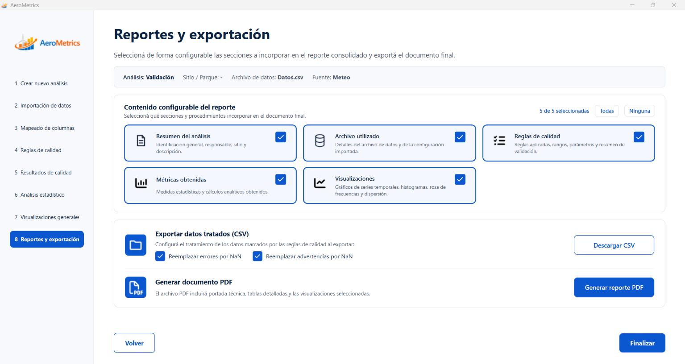

# AeroMetrics

**Aplicación de escritorio para validación y análisis de datos meteorológicos y operativos**

| Dato | Detalle |
| --- | --- |
| Tipo | Proyecto final académico para cliente real |
| Período | 2026, en desarrollo |
| Destinatarios | Grupo de Investigación en Energía Eólica (INEEO) y la carrera de Ingeniería en Energías Renovables (IER) |
| Desarrollo | En equipo |
| Tecnologías principales | Python, PySide6, pandas, DuckDB |

## ¿Qué problema aborda?

El Grupo de Investigación en Energía Eólica (INEEO) utiliza scripts de Python para validar y analizar datos meteorológicos y operativos provenientes de parques eólicos. Sin embargo, su utilización requiere conocimientos técnicos, y los archivos presentan diferencias en sus estructuras, formatos y nombres de variables.

AeroMetrics busca facilitar estos procesos mediante una aplicación de escritorio que centraliza la importación, estandarización, control de calidad y análisis de datos, permitiendo que docentes, investigadores y estudiantes trabajen con la información de forma más accesible y organizada.

## Funcionalidades principales

- Importación de datos: carga de archivos meteorológicos y operativos provenientes de diferentes fuentes.
- Mapeo y estandarización: asociación de columnas con variables estándar para unificar los datos.
- Control de calidad: aplicación de procesos de validación para identificar datos que no cumplen los criterios establecidos.
- Análisis estadístico: herramientas para examinar y comprender el comportamiento de las variables.
- Visualización de resultados: representación gráfica de los datos para facilitar su interpretación.
- Exportación: generación de archivos con datos estandarizados y herramientas de elaboración de reportes.

## Cómo trabajamos

Utilizamos Python como lenguaje principal, PySide6 para la interfaz gráfica, pandas para el procesamiento de datos y DuckDB como base de datos local. También se seleccionaron bibliotecas especializadas para análisis estadístico, visualizaciones y reportes.

Adoptamos una arquitectura modular, con procesamiento local, para organizar las funcionalidades del sistema y facilitar su mantenimiento.

El trabajo incluyó relevamiento de requerimientos, investigación de tecnologías, desarrollo, pruebas y validaciones con el cliente. Nos organizamos mediante distribución de responsabilidades, reuniones de seguimiento y control de versiones con GitHub.

## Evidencia visual

## Código fuente

El repositorio de desarrollo es privado. 
