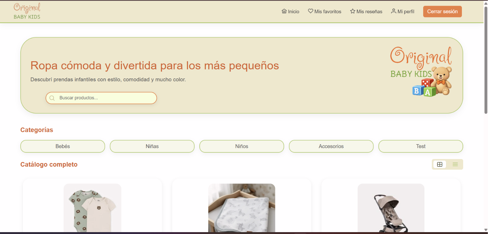
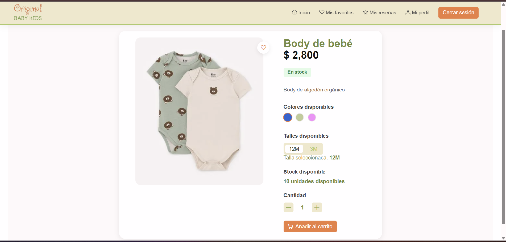
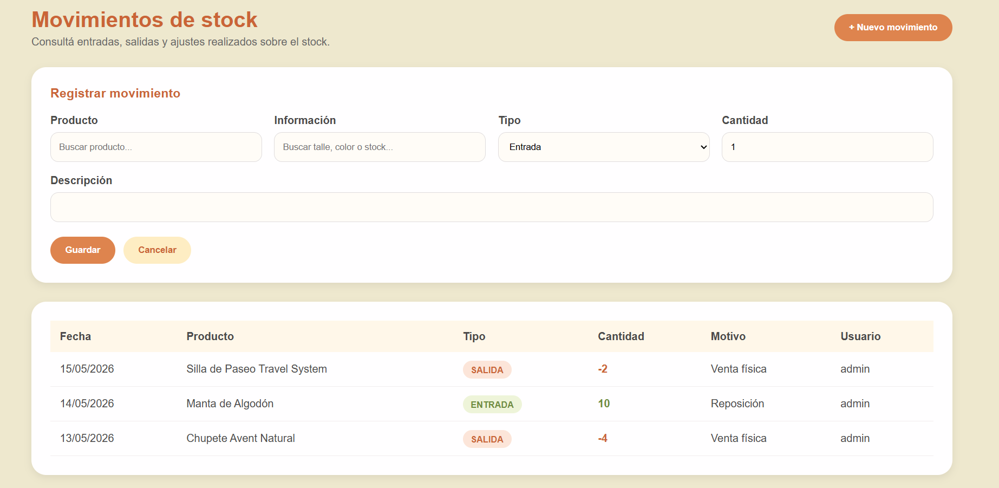

# Original Baby Kid Store

**Aplicación web para un emprendimiento de ropa de bebés y niños**

| Dato | Detalle |
| --- | --- |
| Tipo | Proyecto académico |
| Período | Abril a junio de 2026 |
| Destinatarios | Cliente Real |
| Desarrollo | En equipo |
| Tecnologías principales | Java, Angular |

## ¿Qué problema aborda?

Original Baby Kids Store es un emprendimiento de indumentaria infantil artesanal ubicado en Paysandú, que gestionaba principalmente sus productos y pedidos a través de redes sociales y mensajes. Esta modalidad dificultaba la consulta del catálogo, el seguimiento de pedidos, el control del stock y la organización de la información del negocio.

El proyecto consistió en desarrollar una aplicación web de comercio electrónico adaptada a las necesidades del cliente, con el objetivo de facilitar la consulta de productos y centralizar la gestión comercial.

## Funcionalidades principales

- Catálogo de productos: visualización de prendas infantiles con su información correspondiente.
- Búsqueda y categorías: organización y filtrado de productos para facilitar la navegación.
- Carrito de compras: selección de productos antes de realizar un pedido.
- Gestión de pedidos: funcionalidades para organizar y consultar los pedidos del comercio.
- Integración con WhatsApp: comunicación con el emprendimiento para concretar las solicitudes de compra.
- Panel administrativo: herramientas para gestionar productos, categorías, stock, pedidos y usuarios.
- Funciones comerciales adicionales: opciones de descuentos, favoritos y reseñas contempladas en la solución.

## Cómo trabajamos

Utilizamos Java con Spring Boot para el backend y Angular con PrimeNG para el frontend. Para la persistencia de datos trabajamos con PostgreSQL y Supabase, mientras que Git y GitHub nos permitieron gestionar el código y colaborar durante el desarrollo.

Organizamos la aplicación mediante componentes y capas que separan las responsabilidades de acceso a datos, lógica de negocio y presentación.

## Evidencia visual

## Código fuente

El repositorio de desarrollo es privado. 
