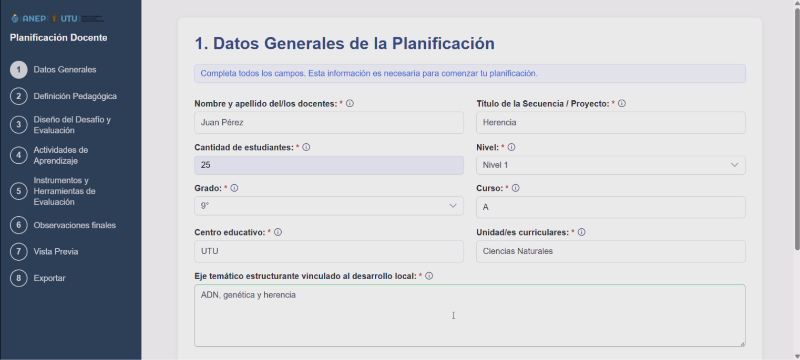
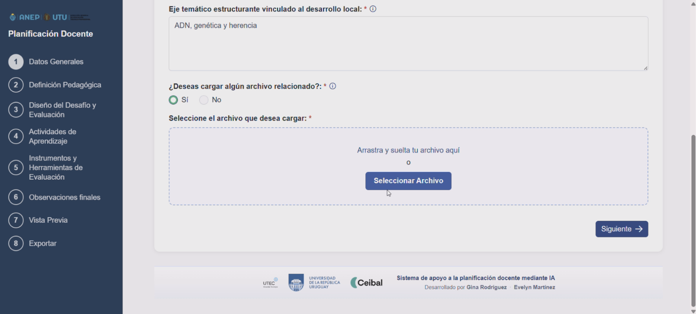
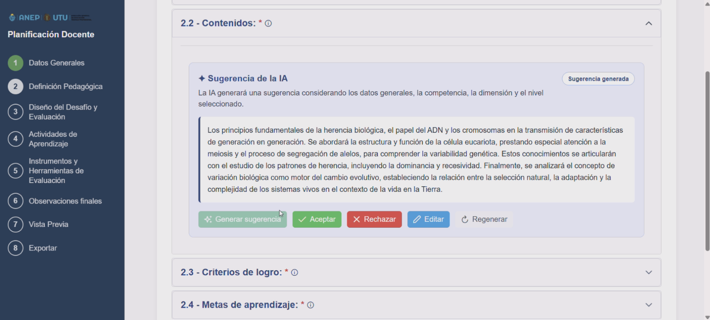
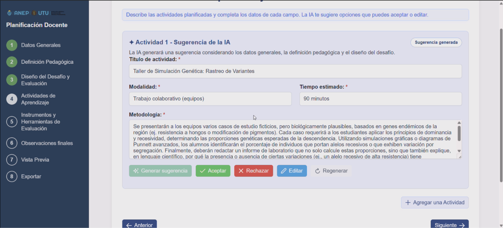
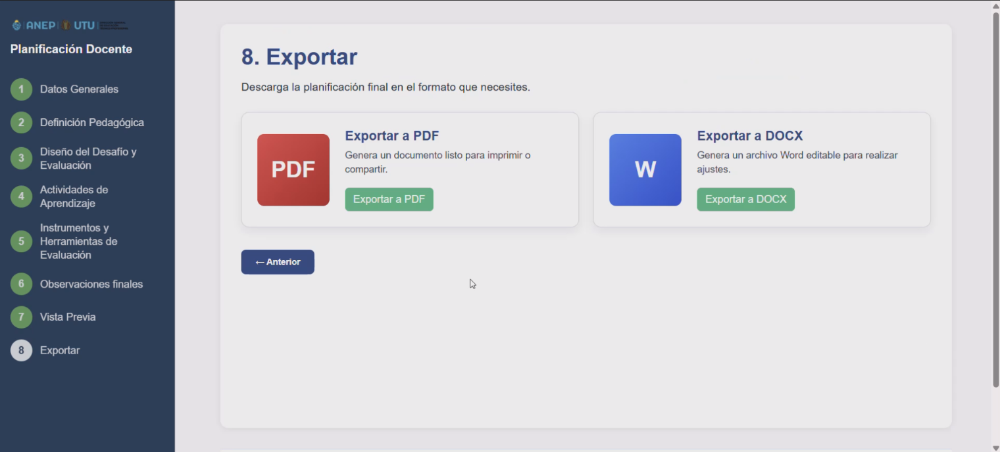

# Planificación Docente con IA

**Aplicación web para apoyar la elaboración de planificaciones educativas**

| Dato | Detalle |
| --- | --- |
| Tipo | Pasantía curricular |
| Período | Mayo a julio de 2026 |
| Destinatarios | UTU y Ceibal |
| Desarrollo | En equipo |
| Tecnologías principales | Python, FastAPI, Angular, TypeScript, HTML y CSS |

## ¿Qué problema aborda?

La elaboración de planificaciones docentes requiere organizar información pedagógica, definir competencias, seleccionar contenidos, establecer actividades y preparar instrumentos de evaluación, lo que puede demandar tiempo y esfuerzo.

El proyecto Planificación Docente con IA busca facilitar este proceso mediante una plataforma web que guía a los docentes paso a paso y utiliza inteligencia artificial generativa como herramienta de apoyo para la elaboración de sus planificaciones.

La solución permite combinar las decisiones pedagógicas del docente con sugerencias generadas por IA, manteniendo el control del contenido en manos del usuario.

## Funcionalidades principales

- Planificación guiada: recorrido por diferentes etapas para completar una planificación docente de forma organizada.
- Datos generales: registro de información del docente, centro educativo, nivel, grado y características del grupo.
- Asistencia con inteligencia artificial: generación de sugerencias pedagógicas para apoyar la definición de competencias, contenidos y otros elementos de la planificación.
- Edición de sugerencias: posibilidad de aceptar, modificar, rechazar o regenerar el contenido propuesto por la IA.
- Organización pedagógica: elaboración de actividades, instrumentos de evaluación y observaciones finales.
- Carga de documentos: incorporación de archivos como información de apoyo.
- Exportación: generación de planificaciones en formatos PDF y DOCX.

## Cómo trabajamos

Trabajamos en el desarrollo de una aplicación full stack, utilizando Angular y TypeScript para el frontend y Python con FastAPI para el backend. Para integrar la inteligencia artificial utilizamos Ollama y Gemma 4, mientras que para la generación de documentos se emplearon WeasyPrint y python-docx.

El desarrollo incluyó diseño de interfaces, reuniones con docentes, investigación de herramientas de IA, implementación de frontend y backend, integración mediante API REST y documentación técnica.

Utilizamos Git para el control de versiones y un entorno Linux para el trabajo con el servidor.

## Evidencia visual

## Código fuente

El repositorio de desarrollo es privado. 