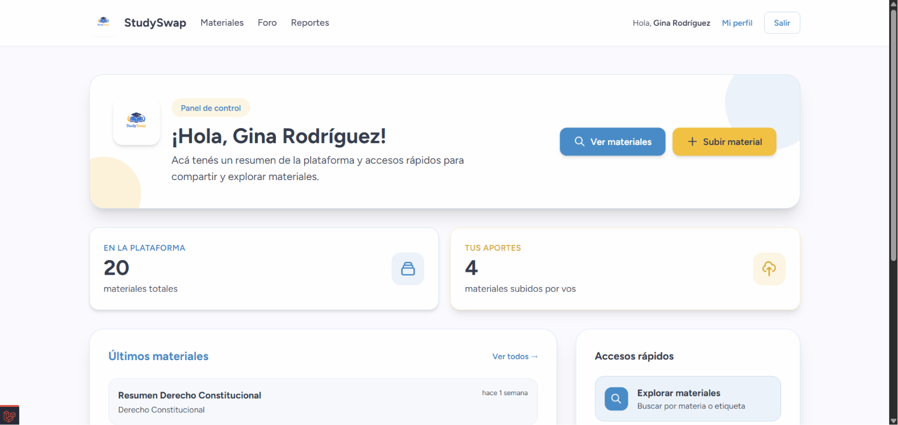
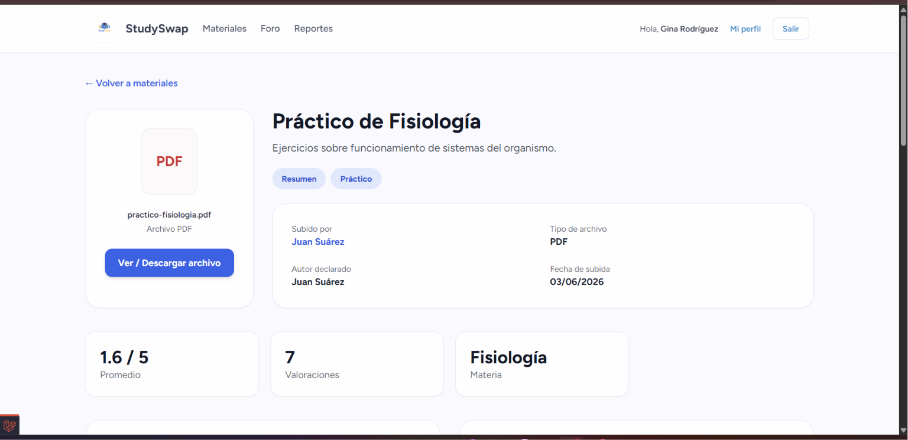
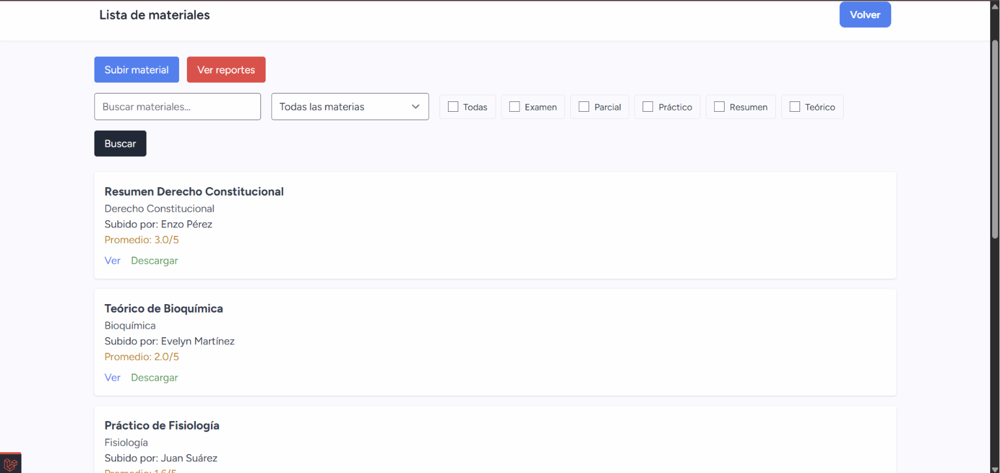

# Study Swap

**Plataforma de intercambio de materiales de estudio**

| Dato | Detalle |
| --- | --- |
| Tipo | Proyecto académico |
| Período | Abril a junio de 2026 |
| Destinatarios | - |
| Desarrollo | En equipo |
| Tecnologías principales | PHP, Laravel, Blade |

## ¿Qué problema aborda?

Los estudiantes suelen compartir apuntes, resúmenes y otros materiales académicos mediante aplicaciones de mensajería o servicios de almacenamiento como WhatsApp y Google Drive. Aunque estas herramientas permiten compartir archivos, la información puede quedar dispersa, desorganizada o desactualizada, dificultando encontrar materiales relevantes y evaluar su utilidad.

StudySwap surge como una plataforma web colaborativa que busca centralizar los recursos académicos, facilitar su búsqueda y promover el intercambio de conocimientos entre estudiantes.

## Funcionalidades principales

- Publicación de materiales: posibilidad de compartir apuntes, resúmenes y otros documentos académicos.
- Descarga de recursos: acceso a materiales publicados por otros estudiantes.
- Organización de contenidos: clasificación de documentos por materias y etiquetas.
- Búsqueda de materiales: localización de recursos académicos de manera sencilla.
- Valoraciones: sistema para evaluar la utilidad de los documentos compartidos.
- Reportes de contenido: mecanismos para señalar materiales que requieran revisión.
- Administración: panel para gestionar y supervisar la plataforma.

## Cómo trabajamos

Utilizamos PHP con Laravel para el desarrollo de la aplicación, Blade y Tailwind CSS para la interfaz, y PostgreSQL con Supabase para la gestión de datos. También incorporamos herramientas del ecosistema Laravel, como Breeze y Filament.

El desarrollo se organizó utilizando Git y GitHub, con ramas individuales para distribuir el trabajo y facilitar la integración de cambios. Realizamos planificación semanal, estimación de tareas y reuniones periódicas para coordinar avances y resolver dificultades.

Debido al tiempo disponible, priorizamos el desarrollo de un MVP (Producto Mínimo Viable) centrado en las funcionalidades esenciales.

## Evidencia visual

## Código fuente

El repositorio de desarrollo es privado. 
